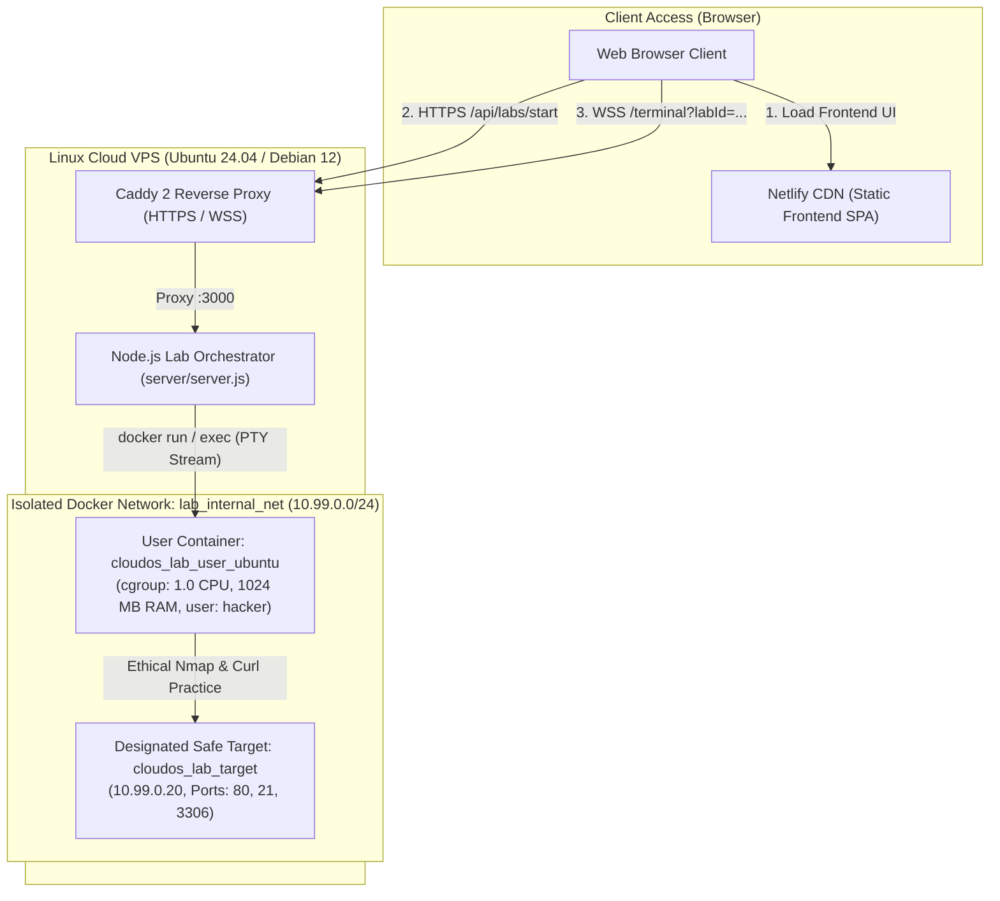

# Deployment & Architecture Guide: Online Linux Hacking Lab

This guide explains how to deploy the **Online Linux Hacking Lab** on your Linux VPS with Docker, and link it seamlessly to your static frontend hosted on **Netlify**.

---

## 🏗️ Architecture Topology



---

## 📋 System Prerequisites

On your separate Linux VPS:
- **Operating System**: Ubuntu 22.04/24.04 LTS or Debian 12 (ARM64 or x86_64).
- **Compute**: Minimum 2 vCPU, 2 GB to 4 GB RAM (Free Tier such as Oracle Ampere A1 4 OCPU / 24 GB is ideal).
- **Docker**: Docker Engine 24+ and Docker Compose v2.
- **Firewall**: Ports `80` (HTTP) and `443` (HTTPS) open.

---

## 🚀 Step-by-Step VPS Setup

### Step 1: Install Docker on the VPS
```bash
# Update and install Docker
curl -fsSL https://get.docker.com -o get-docker.sh
sudo sh get-docker.sh

# Add your user to the docker group
sudo usermod -aG docker $USER
newgrp docker
```

### Step 2: Clone or Copy the Repository
```bash
git clone https://github.com/punitkumarsaini2008-debug/New-folder-4-.git /opt/cloudos
cd /opt/cloudos
```

### Step 3: Build the Lab Container Images
```bash
# Build the Ubuntu, Kali, and Parrot lab environments + internal target
docker compose -f docker-compose.labs.yml build
```

### Step 4: Configure Environment & Domain
Create your `.env` configuration file:
```bash
cp server/.env.example server/.env
nano server/.env
```
Ensure your `CORS_ORIGIN` is set to your Netlify domain (or `*`), and specify your VPS domain:
```ini
DOMAIN=api.yourdomain.com
JWT_SECRET=generate_a_random_64_character_hex_secret_here
MAX_CONCURRENT_SESSIONS=8
CONTAINER_RAM_LIMIT_MB=1024
CONTAINER_CPU_QUOTA=1.0
```

### Step 5: Start the Platform Stack
```bash
# Start Caddy, Node.js Backend, PostgreSQL, and guacd
docker compose up -d

# Start the designated safe target container on 10.99.0.20
docker compose -f docker-compose.labs.yml up -d lab-target
```

Check that the containers are healthy:
```bash
docker ps
```

---

## 🔒 Security Hardening & Isolation Controls

1. **Non-Root Execution**:
   - Containers run under the unprivileged `hacker` user (`UID 1000`).
   - Sudo is strictly limited in `/etc/sudoers` to safe diagnostic binaries.
2. **Resource Constraints (cgroups)**:
   - Each container is hard-capped at **1024 MB RAM** and **1.0 CPU Core**.
   - Process limit (`--pids-limit=128`) prevents fork-bomb attacks.
3. **Network Isolation**:
   - User containers attach strictly to `lab_internal_net` (`10.99.0.0/24`).
   - Host LAN, internal Docker management ports, and host loopback (`127.0.0.1`) are unreachable.
4. **Target Authorization**:
   - The designated target (`10.99.0.20`) runs inside `lab_internal_net` specifically for ethical reconnaissance (Nmap scanning, HTTP header analysis).
5. **Automatic Session Reaper**:
   - Sessions automatically destroy and free RAM/CPU after **45 minutes** of inactivity.

---

## 🌐 Netlify Frontend Integration

Your static frontend on Netlify connects directly to your backend VPS via HTTPS/WSS:

1. In the WebOS desktop UI, open **Settings** $\rightarrow$ **Cloud Infrastructure**.
2. Set the **Backend REST & WebSocket Endpoint** to your VPS domain:
   ```text
   https://api.yourdomain.com
   ```
3. Or save it in `localStorage` by running in the browser console:
   ```javascript
   localStorage.setItem('cloudos_api_base', 'https://api.yourdomain.com');
   ```
4. Click the new **Cyber Lab** button in the top navigation panel or desktop icon to launch an isolated shell!

---

## 🧪 Verification & Real Command Execution

Once connected to your lab container, test real execution with these commands:

| Command | Expected Output / Verification |
| :--- | :--- |
| `whoami && id` | `hacker` (uid=1000, gid=1000) |
| `uname -a` | Real Linux kernel identification |
| `ls -la` | Displays files including `.secret_flag.txt` |
| `python3 --version` | `Python 3.12.x` |
| `nmap -sV 10.99.0.20` | Scans designated target, finds port 80 open (Nginx) |
| `curl -i http://10.99.0.20` | Returns `X-Lab-Token: FLAG{http_header_token_recon_8820}` |
