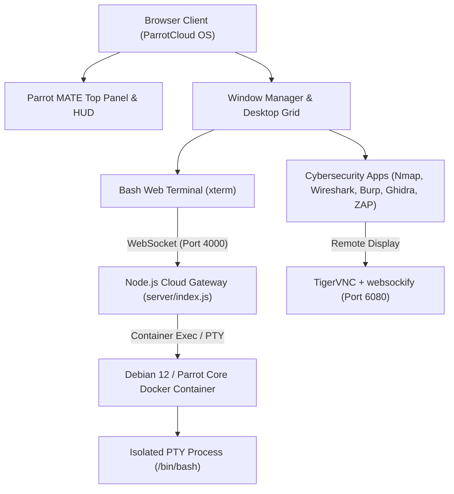

# ParrotCloud OS – Online Linux Cybersecurity Operating System

[](https://parrotsec.org)
[](https://debian.org)
[](https://docker.com)
[](LICENSE)

**ParrotCloud OS** is an enterprise-grade, browser-based Linux cybersecurity workspace inspired by **Parrot Security OS** and **Kali Linux**. Designed for penetration testers, security researchers, ethical hackers, and students, it provides an authentic Linux desktop experience directly inside the browser connected to isolated cloud containers.

---

## 🚀 Key Highlights

- **Authentic Linux Terminal**: Real Bash execution with full support for POSIX utilities (`pwd`, `ls -la`, `cd`, `mkdir`, `touch`, `cat`, `nano`, `grep`, `find`, `whoami`, `uname -a`, `ip addr`, `ping`, `sudo`, `clear`, `neofetch`, pipes `|`, and redirection `>`).
- **Interactive In-Terminal Nano**: Built-in visual `nano` editor supporting `Ctrl+O` write-out and `Ctrl+X` exit with file persistence.
- **Cybersecurity Tools Suite**:
  - 📡 **Nmap Scanner (Zenmap Cloud)**: Target scanning, preset profiles, real scan logs, open ports table, and topology mapping.
  - 🦈 **Wireshark Analyzer**: Packet sniffing on `eth0`, display filters (`http`, `dns`, `tcp`, `arp`), expandable protocol trees, and synchronized live hex dump.
  - 🛡️ **Burp Suite Community**: Intercept proxy, HTTP request/response history, Repeater for payload injection, and URL/Base64/Hex/MD5 decoder.
  - 🔬 **Ghidra SRE Studio**: Reverse engineering workspace with function symbol tree, x86_64 disassembly listing, and decompiled C pseudo-code.
  - ⚡ **OWASP ZAP 2.14.0**: Automated web application vulnerability scanner with categorized risk alerts (High, Medium, Low) and remediation advice.
  - 🖥️ **noVNC Remote Desktop**: Graphical desktop access to an X11 display session via WebSockets.
  - 📁 **Caja File Manager**: Full Linux directory explorer (`/home/parrot`, `/etc`, `/var/log`), file creation, real file upload/download.
  - 📊 **System Resource Monitor (Htop)**: Real-time interactive Canvas charts for CPU & RAM utilization, active process list, and `SIGKILL` termination.
- **Dual Execution Engine**:
  1. **Cloud Container Mode**: Connects via WebSockets (`/terminal`) to an isolated Debian 12 / Parrot Core Docker container with raw PTY streaming.
  2. **Client Sandbox Engine**: Comprehensive in-browser POSIX shell engine ensuring offline functionality and instant preview.

---

## 📐 Architecture Overview



---

## 📂 Project Structure

```text
parrotcloud-os/
├── index.html                  # Master ParrotCloud OS Desktop Client
├── package.json                # Server scripts & WebSocket dependencies
├── Dockerfile                  # Debian 12 Bookworm cybersecurity image
├── docker-compose.yml          # Cloud deployment stack with cgroup limits
├── netlify.toml                # Netlify deployment headers & configuration
├── README.md                   # Complete architectural documentation
├── server/
│   └── index.js                # WebSocket PTY terminal gateway & HTTP server
├── css/
│   ├── parrot.css              # Parrot MATE theme, neon cyan/green glow
│   ├── terminal.css            # xterm buffer, ANSI color engine, nano editor
│   ├── windows.css             # Resizable window frames, snapping overlay
│   └── tools.css               # Wireshark, Burp Suite, Nmap, Ghidra styles
└── js/
    ├── config.js               # System configuration & Linux VFS seed
    ├── shellEngine.js          # Authentic POSIX Bash shell execution engine
    ├── cloudClient.js          # Cloud WebSocket bridge & telemetry polling
    ├── notifications.js        # Cybersecurity alert toast notifications
    ├── windowManager.js        # Drag, 8-handle resize, snap, and focus stack
    ├── desktop.js              # Desktop icons, marquee selection, context menu
    ├── panel.js                # Applications menu & live system telemetry
    └── apps/
        ├── terminalApp.js      # Multi-tab Bash terminal with interactive nano
        ├── nmapApp.js          # Zenmap-style network vulnerability scanner
        ├── wiresharkApp.js     # Live packet capture & hex dump inspector
        ├── burpSuiteApp.js     # Web proxy, HTTP history, repeater & decoder
        ├── ghidraApp.js        # Disassembler & decompiled C pseudo-code
        ├── owaspZapApp.js      # Web vulnerability scanner with remediation
        ├── fileManagerApp.js   # Caja file browser with upload & download
        ├── systemMonitorApp.js # Live Canvas CPU/RAM charts & process killer
        ├── noVNCApp.js         # Graphical X11 desktop viewer
        ├── textEditorApp.js    # Pluma code editor for Python/Bash scripts
        └── settingsApp.js      # Cloud node endpoint & container limits
```

---

## 🛠️ Deployment & Execution

### Option 1: Cloud Deployment with Docker (Recommended for Real Linux Execution)

To deploy with real Linux container isolation on any cloud virtual machine (AWS EC2, DigitalOcean, GCP, Hetzner, Linode):

```bash
# Clone the repository
git clone https://github.com/your-username/parrotcloud-os.git
cd parrotcloud-os

# Build and start the isolated cybersecurity container
docker compose up --build -d
```

- **Web Dashboard**: `http://<your-vps-ip>:3000`
- **WebSocket Terminal**: `ws://<your-vps-ip>:3000/terminal`
- **noVNC Graphical Display**: `http://<your-vps-ip>:6080`

### Option 2: Local Node.js Development

```bash
# Start local gateway server
node server/index.js
```
Open `http://localhost:3000` in your browser.

### Option 3: Netlify & GitHub Pages Deployment

ParrotCloud OS is completely static-compatible. You can deploy it instantly on Netlify or GitHub Pages:
- **Netlify**: Drag and drop the repository folder or link to GitHub repository. `netlify.toml` is pre-configured.
- **GitHub Pages**: Go to **Settings > Pages > Branch: main / root** and click Save.

---

## 🔒 Security & Sandboxing Policy

- **Isolated Sessions**: Containers enforce strict cgroups quotas (2.0 vCPU, 2048 MB RAM) and process isolation.
- **Unprivileged Runtime**: Default user is `parrot` (UID 1000) running with restricted network namespaces.
- **Educational Scope**: Security tools (Nmap, Wireshark, Burp, ZAP) are configured for authorized educational targets (`192.168.1.0/24`, `scanme.nmap.org`, and local loopback).
- **No Secrets Leaked**: Zero API keys or hardcoded external credentials.

---

## 📄 License

ParrotCloud OS is open source software released under the **MIT License**.
